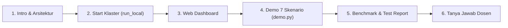

# Panduan Setup Otomatis & Skenario Presentasi — RemoteLab v2.0

Panduan ini disusun untuk memudahkan rekan tim atau penguji menjalankan proyek ini dari nol secara otomatis (*1-click automated setup*), serta memberikan alur dan panduan langkah-demi-langkah (*cheat sheet*) untuk mempresentasikan **RemoteLab v2.0** di hadapan dosen penguji / audiens.

---

## BAGIAN I: PANDUAN SETUP CEPAT UNTUK TEMAN / REKAN TIM

Saat berkas proyek ini dibagikan ke teman atau dipindahkan ke komputer baru, mereka **TIDAK PERLU** menginstal dependensi secara manual. Sistem sudah dilengkapi skrip otomatisasi penuh.

### Prasyarat Sistem
- **Sistem Operasi:** Windows 10/11.
- **Python:** *Opsional / Otomatis!* Jika di komputer belum ada Python atau terpasang versi yang tidak kompatibel (seperti Python 3.14+), skrip setup otomatis mengunduh **Python 3.12 mandiri (terisolasi khusus proyek ini)** tanpa mengotori sistem global dan tanpa hak Administrator.

---

### Cara 1: Setup Otomatis 1-Klik (Windows)

- **Cara Paling Praktis (File Explorer):** Cukup buka folder `remotelab` di File Explorer dan **double-click `setup.bat`**. Jendela command prompt akan terbuka, otomatis mem-bypass batasan izin PowerShell, membuat `.venv`, dan memasang dependensi.
- **Atau via Terminal PowerShell:**
  1. Buka folder `remotelab` di terminal **PowerShell**:
     ```powershell
     cd remotelab
     ```
  2. Jalankan skrip setup:
     ```powershell
     .\setup.bat
     ```
   *Skrip ini akan secara otomatis:*
   - Mendeteksi interpreter Python di sistem.
   - Membuat *Virtual Environment* (`.venv`) jika belum ada.
   - Meng-upgrade `pip` dan memasang seluruh pustaka di `requirements.txt` (FastAPI, Uvicorn, Pydantic, HTTPX, Pytest, NumPy).
   - Memverifikasi integritas paket dan membuat folder data `run_data`.

> [!TIP]
> **Bahkan lebih mudah:** Jika teman Anda langsung menjalankan `.\scripts\run_local.ps1`, skrip akan mendeteksi jika `.venv` belum ada dan **otomatis menjalankan `setup.bat` terlebih dahulu**, lalu langsung menyalakan klaster!

---

### Cara 2: Setup Skenario 4 Laptop Terpisah (4 Anggota Kelompok)

Jika kelompok Anda membawa 4 laptop terpisah ke ruang presentasi:
1. Hubungkan seluruh 4 laptop ke **1 hotspot Wi-Fi yang sama**.
2. Cek IP masing-masing laptop via `ipconfig` (misal: Laptop 1: `192.168.43.10`, Laptop 2: `192.168.43.11`, Laptop 3: `192.168.43.12`, Laptop 4: `192.168.43.13`).
3. **Laptop 2, 3, 4 (Worker):** Jalankan `.\scripts\run_cluster_executor.ps1` (atau `run_executor.bat`) lalu pilih peran 1, 2, atau 3.
4. **Laptop 1 (Master):** Jalankan `.\scripts\run_cluster_scheduler.ps1` (atau `run_scheduler.bat`) dan ketikkan IP Laptop 2, 3, dan 4 saat diminta.
5. Buka dashboard di browser Laptop 1: `http://192.168.43.10:8000`.

---

## BAGIAN II: ALUR DAN SKENARIO PRESENTASI (LIVE DEMO)

Berikut adalah panduan alur presentasi 10–15 menit yang terstruktur untuk menunjukkan seluruh keunggulan teknis dari **6 Pilar Sistem Terdistribusi**.



---

### Langkah 1: Buka Terminal & Jalankan Klaster
- **Opsi A (Jika memakai 4 Laptop Terpisah):**
  - Di Laptop 2, 3, 4: Jalankan `.\scripts\run_cluster_executor.ps1` (pilih peran 1, 2, 3).
  - Di Laptop 1: Jalankan `.\scripts\run_cluster_scheduler.ps1` (masukkan IP Laptop 2, 3, 4).
- **Opsi B (Jika latihan/demo di 1 Laptop saja):**
  - Jalankan `.\scripts\run_local.ps1` (otomatis menyalakan 1 Scheduler :8000 + 3 Executor :9001-:9003 di localhost).

**Poin yang dijelaskan ke audiens/dosen:**
> *"Sistem menyalakan arsitektur terdistribusi: 1 Scheduler sebagai Master pada port 8000, serta 3 Node Executor (`exec1`, `exec2`, `exec3`) sebagai Slave dan Peer. Ketiga executor ini otomatis saling menemukan dan membentuk topologi cincin Chord DHT 32-bit melalui node bootstrap."*

---

### Langkah 2: Buka Web Dashboard di Browser
1. Buka browser ke alamat: **`http://127.0.0.1:8000/`**
2. **Poin yang ditunjukkan pada Dashboard:**
   - **Visualisasi Topologi Chord DHT:** Tunjukkan cincin node dengan ID Chord masing-masing (dihitung dari hash SHA-1 alamat).
   - **Daftar Node Executor:** Tunjukkan status `HEALTHY`, kapasitas slot, memori, dan beban kerja aktif masing-masing node.
   - **Monitoring Antrean Job:** Menampilkan tugas secara real-time dari status `QUEUED`, `RUNNING`, hingga `SUCCESS`.
   - **Form Pengujian Interaktif:** Anda dapat mencoba mengeksekusi kode Python sederhana langsung dari dashboard web.

---

### Langkah 3: Jalankan Demo Otomatis 7 Skenario
1. Buka **jendela terminal kedua** (biarkan klaster tetap menyala di terminal pertama).
2. Jalankan perintah demo:
   ```powershell
   .\.venv\Scripts\python.exe scripts\demo.py
   ```
3. **Penjelasan untuk setiap skenario yang tampil di layar:**

| Skenario di Terminal | Pilar yang Dibuktikan | Penjelasan Singkat ke Dosen |
|---|---|---|
| **Skenario 1:** Eksekusi Normal | *Pilar 1 (Master-Slave) & Pilar 3 (REST API)* | Job dikirim via `POST /api/v1/jobs` (HTTP 202 Accepted), dijadwalkan oleh scheduler ke worker paling longgar, dan output diambil dari Chord DHT. |
| **Skenario 2:** Edge Cache & ETag 304 | *Pilar 6 (Caching)* | Kode yang sama dikirim ulang dengan flag `cache=True`. Permintaan selesai dalam **< 10 ms (Cache Hit)** tanpa eksekusi ulang. Request ETag mengembalikan **HTTP 304 Not Modified**. |
| **Skenario 3:** Isolasi Timeout | *Pilar 1 (Sandbox Security)* | Kode loop tak hingga `while True: pass` dihentikan paksa tepat pada batas waktu timeout tanpa menggantung worker. |
| **Skenario 4:** Dedup RPC At-Most-Once | *Pilar 4 (JSON-RPC 2.0)* | Panggilan RPC dengan ID sama dikirim berulang kali. Node worker hanya mengeksekusi 1 kali; panggilan berikutnya mengambil hasil dari SQLite dedup store. |
| **Skenario 5:** Routing Chord DHT | *Pilar 2 (Chord Naming)* | Lookup kunci pada cincin Chord. Menampilkan jalur lompatan (*hop path*) finger table yang membuktikan pencarian konvergen dalam $O(\log N)$ langkah. |
| **Skenario 6:** Failover & Pemulihan | *Pilar 1 (Fault Tolerance)* | Menunjukkan mekanisme heartbeat scheduler mendeteksi kegagalan node dan mengalihkan job ke node yang bertahan. |
| **Skenario 7:** Inverted Index Search | *Pilar 2 & 3 (Distributed Search)* | Menelusuri output jobs terdistribusi menggunakan kata kunci unik via endpoint `GET /api/v1/search?q=...`. |

---

### Langkah 4: Tunjukkan Laporan Benchmark & Pengujian Unit
Buka atau tampilkan dokumen laporan resmi yang telah digenerate:
1. **Laporan Benchmark Empiris:** [`docs/BENCHMARK.md`](BENCHMARK.md)
   - Tunjukkan metrik **Speedup Paralel 1.82× – 3.19×** pada 30 job paralel.
   - Tunjukkan latensi Cache Hit **~4 ms** (target kriteria $<100\text{ ms}$).
   - Tunjukkan rata-rata hop Chord **1.33 hop** (batas teoretis $\le 2\text{ hop}$).
2. **Laporan Pengujian Otomatis:** [`docs/TEST_REPORT.md`](TEST_REPORT.md)
   - Tunjukkan bukti eksekusi `pytest`: **24 passed, 3 skipped, 0 failed (100% Pass Rate)**.
   - Tunjukkan 10 skenario integrasi klaster semuanya **PASSED**.

---

## BAGIAN III: BANTUAN MENJAWAB PERTANYAAN KRITIS DOSEN (FAQ CHEAT SHEET)

Berikut contekan jawaban teknis jika dosen penguji menanyakan hal-hal mendalam seputar sistem terdistribusi:

#### Q1: "Mengapa arsitekturnya disebut Hybrid Master-Slave dan Peer-to-Peer?"
> **Jawaban:**  
> *"RemoteLab menggabungkan dua pola arsitektur untuk mendapatkan kelebihan masing-masing:  
> 1. **Master-Slave (Scheduler ke Executor):** Scheduler bertindak sebagai Master tunggal untuk menerima submit job dari client, mengelola antrean FIFO terpusat, dan mendistribusikan job ke Executor (Slave). Ini memberikan koordinasi yang cepat dan deterministik.  
> 2. **Peer-to-Peer (Antar-Executor):** Seluruh Executor membentuk jaringan cincin P2P terdistribusi menggunakan protokol **Chord DHT ($m=32$)**. Penyimpanan hasil eksekusi dan inverted index pencarian tidak disimpan di satu server pusat, melainkan disebar merata di antara para peer dengan replikasi $r=2$. Jadi tidak ada single point of failure untuk penyimpanan data."*

#### Q2: "Bagaimana sistem menjamin semantik At-Most-Once pada RPC?"
> **Jawaban:**  
> *"Setiap node executor memiliki database SQLite lokal dengan mode Write-Ahead Logging (WAL). Sebelum eksekusi sandbox dimulai, executor mengeksekusi transaksi atomik `INSERT OR IGNORE` ke tabel dedup berdasarkan `job_id`. Jika `job_id` sudah pernah diproses atau sedang berjalan, eksekusi fisik dibatalkan dan executor langsung mengembalikan status atau hasil yang sudah tersimpan sebelumnya. Ini mencegah eksekusi ganda meskipun scheduler melakukan retry akibat timeout jaringan."*

#### Q3: "Bagaimana cara kerja pencarian pada Chord DHT dan mengapa dijamin $O(\log N)$?"
> **Jawaban:**  
> *"Setiap node memiliki Finger Table berisi $m=32$ entri, di mana entri ke-$i$ menunjuk ke node pertama yang bertanggung jawab atas ID $(n + 2^i) \pmod{2^m}$. Saat mencari kunci, jika kunci bukan milik successor langsung, node akan meneruskan query ke finger terjauh yang mendahului kunci tersebut. Ini memangkas jarak ke target minimal separuhnya pada setiap lompatan, sehingga waktu pencarian dijamin konvergen dalam batas maksimal $\lceil \log_2(N) \rceil$ hop."*

#### Q4: "Bagaimana konsistensi cache dijaga saat ada job yang dihapus atau gagal?"
> **Jawaban:**  
> *"Scheduler Edge Cache menggunakan pola Check-on-Use dan Invalidation Callback. Setiap entri cache diasosiasikan dengan `job_id` dan diberi masa sewa (*lease/TTL*) serta ETag berbasis hash SHA-256. Jika sebuah job dihapus melalui `DELETE /api/v1/jobs/{id}`, scheduler memicu callback pembatalan (*invalidation*) untuk menghapus seluruh entri cache yang terkait. Jika klien melakukan request dengan `If-None-Match`, scheduler memverifikasi ETag; jika cocok, dikembalikan HTTP 304 Not Modified tanpa serialisasi ulang payload."*

---

## Ringkasan Perintah Penting (Quick Cheat-Sheet)

```powershell
# 1. Setup otomatis pertama kali (klik ganda setup.bat atau jalankan di terminal)
.\setup.bat

# 2. Jalankan klaster lokal
.\scripts\run_local.ps1
# (atau klik ganda run_local.bat)

# 3. Jalankan demo visual 7 skenario
.\.venv\Scripts\python.exe scripts\demo.py

# 4. Jalankan benchmark performa
.\.venv\Scripts\python.exe scripts\benchmark.py

# 5. Jalankan unit test & scenario test
.\.venv\Scripts\pytest.exe -v
```

